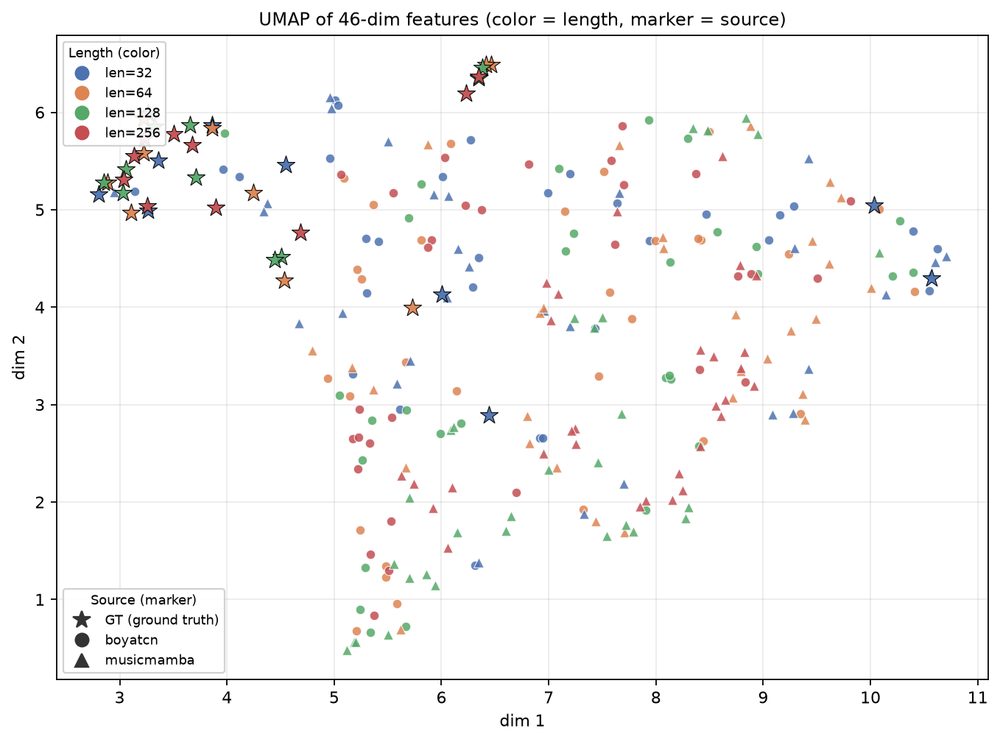
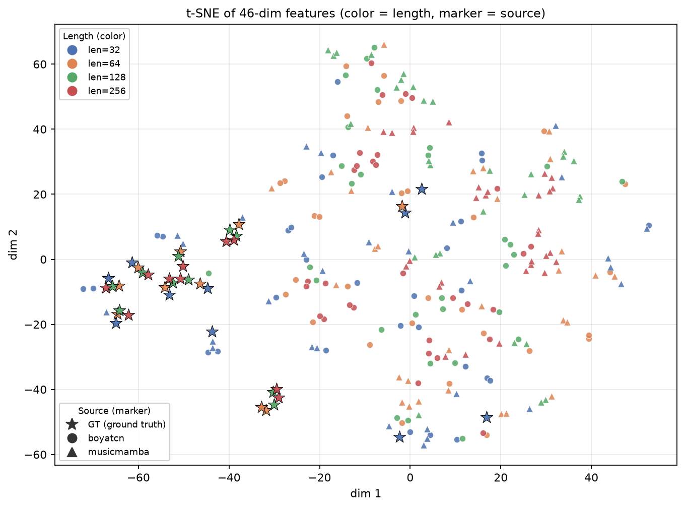

# E5：模型公平对比 + 自回归误差累积漂移
**（BoYaTCN(E3-L3) vs MusicMamba，Tier-1 窗口级符号评估）**

---

## 前置背景（硬性前提，贯穿全文）

1. **本阶段实际包含两个子阶段**：
   - **前置补训（经用户书面授权）**：仓库原本**不存在任何"复合事件口径"的 MusicMamba 权重**
     （现有 `checkpoints/musicmamba/`、`exp2_musicmamba/`、`grid_musicmamba_*` 均为 E1 之前的
     旧单 token 表达产物，词表 128，事件空间不兼容；`train_musicmamba.py` 也只有旧 NOEF 管线）。
     为获得"完全对等条件"的公平对比，按 E3-L3 **逐位相同的**数据窗口、损失、早停口径补训了
     MusicMamba 三籽（种子 2026/2027/2028，best-val 早停 checkpoint）。
   - **正式推理评估**：此后**全程不训练、不微调、不修改权重**，只做推理与统计。
2. **固定 E4 确定的推理采样超参**：`temperature = 1.0`、`top-p = 0.95`、`top-k = 0（不过滤）`。
3. **本实验属于推理层面评估，无法修复训练阶段底层缺陷**：duration / time-shift 词表长尾、
   细档 token 识别准确率低（E2：404 类中 219 类零样本；E3 五组消融 duration token acc 始终
   6.5~7.0%，无一超过 L0 基线）。**所有观测现象如实记录，不做美化。**
4. **评估口径**：prompt = 每个验证窗口前 16 个 GT 事件；评估只统计第 16 个之后的**续写片段**；
   MIDI 后处理开关全部保留但**强制 false**，指标全部基于模型原生输出（不经 MIDI 往返，
   直接评估三路 token 序列，因此非法 token 也如实保留）。

---

## 0. 执行概要

| 项目 | 内容 |
|---|---|
| 分支 | `experiment/E5_model_compare_drift`（自 `experiment/E4_sampling_search` HEAD 新建；E2/E3/E4 冻结只读）|
| 权重 | BoYaTCN：`checkpoints/e3/L3_seed{2026,2027,2028}/best_valloss_model.pt`（E3-L3 早停轮 27/29/27，best epoch 8/9/7） MusicMamba：`checkpoints/e5/musicmamba/L3_seed{2026,2027,2028}/best_valloss_model.pt`（同等条件补训，早停轮 26/27/27，best epoch 6/7/7）|
| 实验组 | 2 模型 × 3 训练种子 × 4 续写长度 × 10 验证窗口 = **240 条序列**，全部真实生成，无缺失、无跳过 |
| 续写长度 | 32 / 64 / 128 / 256（**总长度口径**，含 16 个 prompt → 评估区 = 16 / 48 / 112 / 240 个事件）|
| 验证集 | 沿用 E2/E3/E4 同源 10 个非重叠窗口（dapu14kouhuangtian × 4 + dapu15wujinjiao × 6）|
| GT 天花板 | composite **82.76 ± 1.60**（GT vs 自身，未跳过 prompt）|
| 单元测试 | **28/28 PASS**（见 §5.1），判定明细 `results/e5/e5_infer_consistency_test.json` |

---

## 5.1 单元测试执行结果

命令：`venv/Scripts/python.exe tests/test_e5_infer_consistency.py` → **28/28 PASS**

| 编号 | 校验项 | 结果 |
|---|---|---|
| T0-1 | `postprocess.*` 全部关闭（评估使用原生输出） | PASS |
| T0-2 | 采样固定 `T=1.0 / top_p=0.95 / top_k=0` | PASS |
| T0-3 | `prompt_len=16`，窗口 256 / 步长 256（沿用 E2/E3/E4） | PASS |
| T0-4 | 参与对比模型 = `boyatcn` + `musicmamba` | PASS |
| T0-5 | 两组模型 best-val 早停权重齐备（各 3 籽，共 6 个权重文件） | PASS |
| T0-6 | 验证窗口 = 10，窗口长度 = 256 | PASS |
| **T1**-boyatcn / -musicmamba | **可复现**：同 (权重, rng, 采样参数) 两次推理三路序列**逐位完全一致** | PASS ×2 |
| T4-boyatcn / -musicmamba | 换 rng 后序列不同（证明可复现不是"退化成贪心"） | PASS ×2 |
| **T2**-<模型>-w0/w5/w9 | **prompt 对齐**：生成序列前 16 事件 == 对应窗口 GT 前 16 事件（三路逐位） | PASS ×6 |
| T2-<模型>-region | 评估区域 = 续写片段（如 64 − 16 = 48 事件） | PASS ×2 |
| **T3**-<模型>-32/64/128/256 | **续写长度**：可正确输出 32 / 64 / 128 / 256 长度（三路一致） | PASS ×8 |
| T5-1 / T5-2 | 命名规范 `{song_id}_w{w}_{model}_seed{s}_len{L}.mid`，组合不重复 | PASS ×2 |

---

## 5.2 任务A：BoYaTCN 与 MusicMamba 公平对比（续写长度 = 256）

每组 **30 个样本**（3 训练种子 × 10 验证窗口），全部为原生输出，无后处理。

| 指标 | BoYaTCN (mean ± std) | MusicMamba (mean ± std) | Δ (BoYa − MM) | GT 天花板 |
|---|---|---|---|---|
| **composite（综合）** | **66.87 ± 2.87** | 65.88 ± 1.94 | **+0.99** | 82.76 ± 1.60 |
| mode_matching_score | 83.96 ± 9.94 | **86.32 ± 8.78** | −2.36 | 86.88 ± 6.53 |
| rhythm_consistency | 56.92 ± 2.45 | 56.99 ± 1.74 | −0.07 | 60.29 ± 1.95 |
| tempo_accuracy | **84.69 ± 11.39** | 74.96 ± 10.26 | **+9.73** | 100.00 |
| ornament_score | 73.29 ± 1.59 | 72.85 ± 0.96 | +0.44 | 76.14 ± 1.12 |
| ornament_density | **77.93 ± 7.57** | 74.71 ± 3.61 | +3.23 | 87.96 ± 3.45 |
| pitch_accuracy（Tier-1 逐位） | 8.49 ± 1.99 | 7.74 ± 2.05 | +0.75 | 100.00 |
| gtDist（46 维到同起点等长 GT） | **0.527 ± 0.131** | 0.605 ± 0.136 | −0.079 | 0（定义） |
| 4-gram 重复率 | 0.190 ± 0.119 | 0.216 ± 0.060 | −0.026 | — |
| 非法 token 占比 | **0.0000** | **0.0000** | 0 | — |
| 跨种子多样性（46 维两两距离） | 0.508 | 0.418 | +0.090 | — |

逐籽 composite（检查是否被单个种子主导）：

| seed | BoYaTCN | MusicMamba |
|---|---|---|
| 2026 | **68.84 ± 1.51** | 66.17 ± 2.34 |
| 2027 | 64.71 ± 3.21 | 65.35 ± 1.96 |
| 2028 | 67.05 ± 1.89 | 66.10 ± 1.25 |

配对差（同一窗口 + 同一训练种子，BoYaTCN − MusicMamba）：
**30 对，均值 +0.99，标准差 2.90，BoYaTCN 胜出 18/30 对**。

### 判读（不夸大）

1. **composite 差距在噪声范围内。** Δ=0.99，而配对差标准差高达 2.90、BoYaTCN 仅赢 18/30 对
   （接近抛硬币 + 轻微优势）。因此**不能宣称 BoYaTCN 显著优于 MusicMamba**，
   只能说"Tier-1 综合指标上两者基本持平，BoYaTCN 略占优"。
2. **唯一幅度接近 1 个标准差的差异是 tempo_accuracy（+9.7，各自 σ≈10~11）**：
   BoYaTCN 生成的速度（IOI 分布）更贴近 GT；这是它在 composite 上占优的主要来源。
   MusicMamba 在 mode_matching（调式符合度）上略高，但该优势在长序列下不稳定（见 §5.3）。
3. **teacher-forcing 能力强 ≠ 自回归生成质量好**（重要负向观察，如实记录）：
   MusicMamba 在相同数据与损失下验证 CE 明显更低（6.7288 vs BoYaTCN 6.8570）、
   验证 pitch token acc 明显更高（41.7% vs 35.7%），参数量还少 36%（2.18M vs 3.43M）；
   但自回归生成时它的 Tier-1 逐位 pitch_accuracy 反而略低（7.74 vs 8.49）、
   重复率更高（0.216 vs 0.190）、跨种子多样性更低（0.418 vs 0.508）。
   → 训练期的下一 token 预测优势**没有转化为**生成阶段的整体符号质量优势。

---

## 5.3 任务B：自回归误差累积漂移

折线图：`reports/e5/e5_drift_lines.png`（四面板：composite / gtDist / 4-gram 重复率 / 非法 token 率，
横轴 log2 刻度，误差棒 = 跨 3 籽 × 10 窗口标准差）。

### 5.3.1 四项指标随长度的变化

| 指标 | 模型 | len=32 | len=64 | len=128 | len=256 | △(256−32) |
|---|---|---|---|---|---|---|
| composite | BoYaTCN | 67.74±3.54 | 66.45±3.63 | 66.70±2.69 | 66.87±2.87 | **−0.87** |
| | MusicMamba | 66.98±4.46 | 66.80±2.43 | 64.43±3.93 | 65.88±1.94 | **−1.11** |
| gtDist | BoYaTCN | 1.106±0.30 | 0.705±0.15 | 0.657±0.20 | 0.527±0.13 | −0.579 |
| | MusicMamba | 1.147±0.33 | 0.739±0.15 | 0.764±0.22 | 0.605±0.14 | −0.542 |
| 4-gram 重复率 | BoYaTCN | 0.041 | 0.117 | 0.160 | **0.190** | **+0.149** |
| | MusicMamba | 0.054 | 0.122 | 0.224 | **0.216** | **+0.162** |
| 非法 token 占比 | BoYaTCN | 0.0000 | 0.0000 | 0.0000 | 0.0000 | 0 |
| | MusicMamba | 0.0000 | 0.0000 | 0.0000 | 0.0000 | 0 |

辅助（同样重要）指标：

| 指标 | 模型 | len=32 | len=64 | len=128 | len=256 | 趋势 |
|---|---|---|---|---|---|---|
| pitch_accuracy | BoYaTCN | 14.58 | 11.11 | 9.08 | **8.49** | 单调下降（累积发散） |
| | MusicMamba | 13.54 | 10.07 | 8.78 | **7.74** | 单调下降（衰减更多） |
| cross-seed 多样性 | BoYaTCN | 1.121 | 0.723 | 0.607 | 0.508 | 单调下降 |
| | MusicMamba | 1.153 | 0.751 | 0.693 | 0.418 | 单调下降（更快） |
| mode_matching | MusicMamba | 88.96 | 89.48 | **78.83±15.87** | 86.32 | 长区间出现明显谷值 |

### 5.3.2 分析结论

1. **真正随长度单调恶化的指标是"重复率"和"逐位一致率"，二者互相印证，构成漂移的直接证据。**
   - 4-gram 重复率随长度单调上升 ~3.6 倍（BoYaTCN 0.041→0.190；MusicMamba 0.054→0.216）；
   - Tier-1 pitch_accuracy 随长度单调下降（14.58→8.49；13.54→7.74），即续写越长，
     位置级与 GT 的偏离越大。
   → **自回归误差累积漂移确实存在**，表现为"越写越重复、越写越偏离原旋律"。
2. **composite 几乎不随长度变化（−0.9 / −1.1），说明 composite 对这类退化不敏感。**
   它由 9 项加权构成，其中 tempo/ornament/mode 等分布型指标对"重复化"反应迟钝，
   甚至因样本变多而方差变小、分数略微回升（tempo_accuracy 随长度 +7.7）。
   → **不能只用 composite 判断长序列质量**，必须配合重复率与多样性一起看。
3. **gtDist 随长度"下降"是统计假象，不能解读为"越长越像 GT"。**
   len=32 时评估区只有 16 个事件，46 维里的直方图型分量（pitch-class / 音程 / log-时值 / log-IOI，
   共 40 维）在小样本下方差极大，因此距离被系统性高估。样本越大估计越稳，距离反而下降。
   → 跨长度比较 gtDist 无效；**同长度内**跨模型比较才有效（256 处 BoYaTCN 0.527 < MM 0.605）。
4. **非法 token 占比恒为 0 —— 该维度在本实验中没有分辨力**，原因如实说明：
   top-p=0.95 的核采样把概率质量尾部（BOS/EOS/PAD 等特殊 token 所在区间）整体截断，
   240 条序列的续写片段中 **pitch ≥ 128 的 token 出现 0 次，EOS(id=129) 出现 0 次**。
   → 两个副作用必须记录：① 生成**从不自然终止**，序列长度完全由人为 `target_len` 截断；
   ② 本维度的 0 值是采样策略的结果，**不代表模型不会输出非法 token**（更低 top-p 或更高温度
   下是否出现需另行测试）。
5. **长序列下退化更显著的是 MusicMamba**（多指标一致指向）：
   - 重复率全程高于 BoYaTCN（256 处 0.216 vs 0.190），128 处差距最大（0.224 vs 0.160）；
   - 跨种子多样性掉得更快（0.418 vs 0.508），说明不同初始化最终"收敛到相似的退化模式"；
   - len=128 出现明显的 mode 谷值 78.83（σ=15.87，为全表最差），调式把控在中段长度崩塌；
   - composite 在 len=128 掉到全表最低 64.43，后在 256 回升，波动大于 BoYaTCN。
   → 综合判断：**MusicMamba 的长序列稳定性弱于 BoYaTCN**，尽管它的 teacher-forcing 指标更好。
6. **cross-seed 多样性随长度下降**说明长序列的 46 维特征被大量事件平均化，
   不同训练种子产出差异变小；这也意味着**短序列的多样性数值不可靠**（与小样本方差同源）。

---

## 5.4 任务C：46 维符号特征降维（定性辅助证据）

- **样本集合**：10 个验证窗口 GT（按各长度**同起点等长截取**，即 GT-len32/64/128/256 各 10 点）
  + BoYaTCN 全部（3 籽 × 4 长度 × 10 窗口 = 120）+ MusicMamba 全部（120），**共 280 点**。
- **预处理**：`StandardScaler` 标准化。
- **降维超参（与 exp3 完全一致，保证可复现）**：
  - UMAP：`n_neighbors=8`、`min_dist=0.1`、`random_state=42`
  - t-SNE：`perplexity=5`、`max_iter=2000`、`init=pca`、`random_state=42`
- **特征口径**：仅取**续写片段**（跳过前 16 个 prompt），与 Tier-1 评估口径严格一致。
- **禁止混入**：本图不含 exp3 旧 NOEF 单 token 实验样本（两套事件表示特征空间不兼容）。

### 图注

**`reports/e5/e5_umap_46d.png`** — 46 维符号特征经 StandardScaler 后 UMAP 投影。
**视觉编码：颜色 = 续写长度**（蓝 = 32，橙 = 64，绿 = 128，红 = 256），
**形状 = 来源/模型**（星形 = 验证窗口 GT 真值，黑边加大；圆 = BoYaTCN；三角 = MusicMamba）。
每模型每长度 30 个生成样本（3 籽 × 10 窗口），每长度 10 个等长截取 GT 点。

**`reports/e5/e5_tsne_46d.png`** — 同一批特征、同一编码方案的 t-SNE 投影
（perplexity=5，init=pca，2000 次迭代）。

### 各类簇中心到**同长度 GT 簇中心**的距离（降维空间欧氏距离）

| 降维 | 模型 | len=32 | len=64 | len=128 | len=256 |
|---|---|---|---|---|---|
| UMAP | BoYaTCN | 1.394 | **3.059** | **3.532** | **3.104** |
| UMAP | MusicMamba | 1.753 | 3.907 | 4.104 | 4.390 |
| t-SNE | BoYaTCN | 21.11 | **48.24** | **52.73** | **48.71** |
| t-SNE | MusicMamba | 27.45 | 55.60 | 68.25 | 68.95 |

### 定性解读（**仅作辅助观察，不用于定量论断**）

1. **两种降维方法给出一致的方向性结论**：len=32 时生成点紧邻 GT 簇
   （UMAP 距离 1.4~1.8），到 len=64/128/256 距离显著增大（3.1~4.4）；
   t-SNE 同样从 ~21~27 增大到 ~49~69。这与 §5.3 中"重复率上升 / 逐位一致率下降"互为旁证，
   支持"续写越长、偏离 GT 分布越远"的漂移判断。
2. **MusicMamba 在每个长度上都比 BoYaTCN 更远离 GT 簇**（len=256 UMAP：4.39 vs 3.10；
   t-SNE：68.95 vs 48.71），差幅稳定，与 §5.3 中它更高的重复率、更低的多样性一致。
3. **len=128 的 MusicMamba 簇最散且最远**（UMAP 4.10，t-SNE 68.25），
   与该长度处的 mode/composite 谷值吻合，说明中段长度是 MusicMamba 最不稳定的区间。
4. ⚠ **必须同时看的混杂因素**：len=32 的评估区只有 16 个事件，46 维特征的估计方差极大，
   因此"距离最小"有一部分是**小样本效应**而非真实更贴近 GT；跨长度比较只作趋势参考。
   受样本量（每类 30 点，GT 每长度 10 点）限制，**降维图仅作为定性辅助，不用于定量论断**。

---

## 5.5 实验局限性（如实记录）

1. **推理层评估无法修复训练缺陷**：duration / time-shift 词表长尾与细档 token 识别率低
   （duration token acc ~7%）是训练侧问题，E5 只做采样/长度维度的评估，不解决根因。
   E3 已验证"加分布 KL 损失"对该问题无效，后续应改词表粒度或改回归目标。
2. **验证集极小**：仅 2 首曲目 → 10 个非重叠窗口。所有 std 都包含窗口间差异，
   组间小差距（如 composite Δ≈1）无法达到统计显著。
3. **仅 Tier-1 符号级指标**：未开展音频渲染与人工听测（Tier-2）。
   合成音质、可听性、南韵味等均未评估。
4. **长度口径带来的混杂**：短续写（尤其 len=32，评估区 16 事件）下所有分布型指标
   （46 维特征、重复率、多样性）方差都很大，跨长度比较只能看趋势。
5. **非法率维度被采样策略掩盖**：top-p=0.95 截断了尾部，非法率恒为 0，
   同时 EOS 从未被采样 → 序列从不自然终止；该维度在本实验中没有分辨力。
6. **模型对比的公平性边界**：数据窗口、损失、早停口径、prompt 与采样参数完全对齐，
   但两者参数量不同（MusicMamba 2.18M vs BoYaTCN 3.43M），
   且超参（层数/隐层）沿用各自默认，未做等参数量配平。

---

## 6. 结论清单

| # | 结论 | 证据 |
|---|---|---|
| 1 | 同条件下 MusicMamba 的 teacher-forcing 指标明显更好（val CE 6.7288 vs 6.8570；pitch token acc 41.7% vs 35.7%），但**自回归 Tier-1 生成质量未占优**，composite 反低 0.99（噪声范围内） | §5.2 |
| 2 | 任务A 判为"**基本持平、BoYaTCN 略优**"，主要来自 tempo_accuracy（+9.7）与 ornament_density（+3.2）；配对 18/30 胜出，**不构成显著差异** | §5.2 |
| 3 | 自回归漂移**确实存在**，最清晰的证据是重复率单调上升（~3.6×）与逐位一致率单调下降（~14.6→8.5） | §5.3 |
| 4 | **composite 对漂移不敏感**（仅 −0.9 / −1.1），不能单独用于判断长序列质量 | §5.3 |
| 5 | gtDist 随长度下降是**小样本统计假象**，不可跨长度解读 | §5.3 |
| 6 | 非法率恒 0 源于 top-p=0.95 截断，副作用是**序列从不自然终止** | §5.3 |
| 7 | **MusicMamba 长序列退化更显著**（重复率高、多样性掉更快、len=128 mode 崩塌） | §5.3 / §5.4 |
| 8 | UMAP / t-SNE 的方向性结论与指标一致：生成点随长度远离 GT 簇，MusicMamba 全程更远；**仅为定性辅助** | §5.4 |
